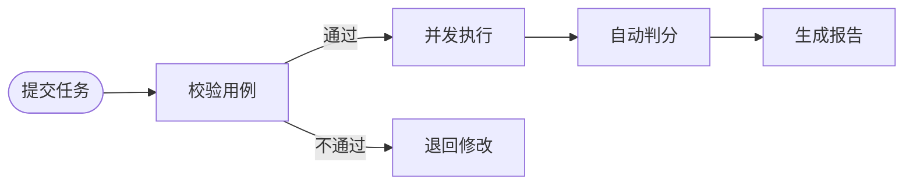
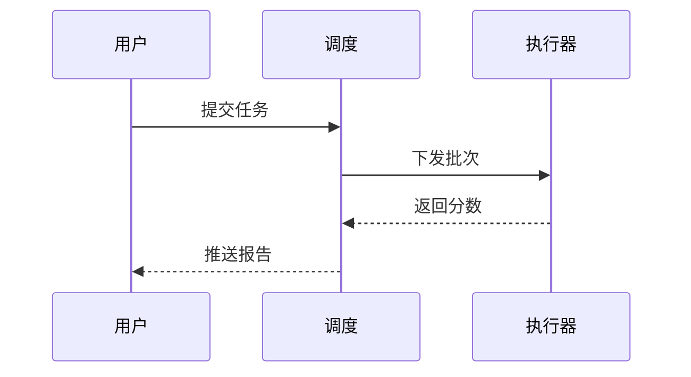
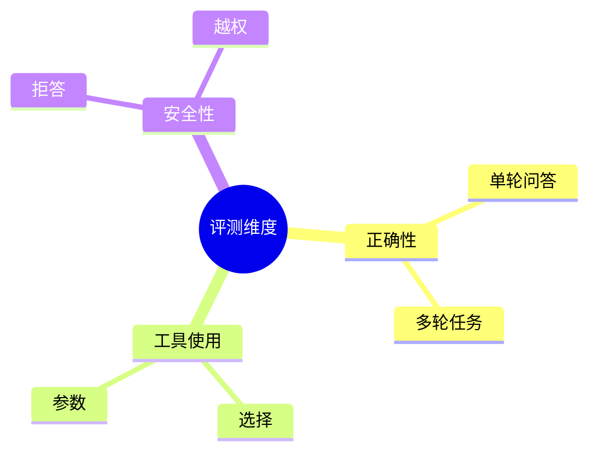
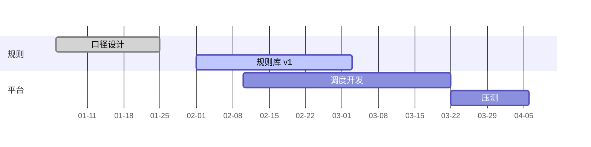
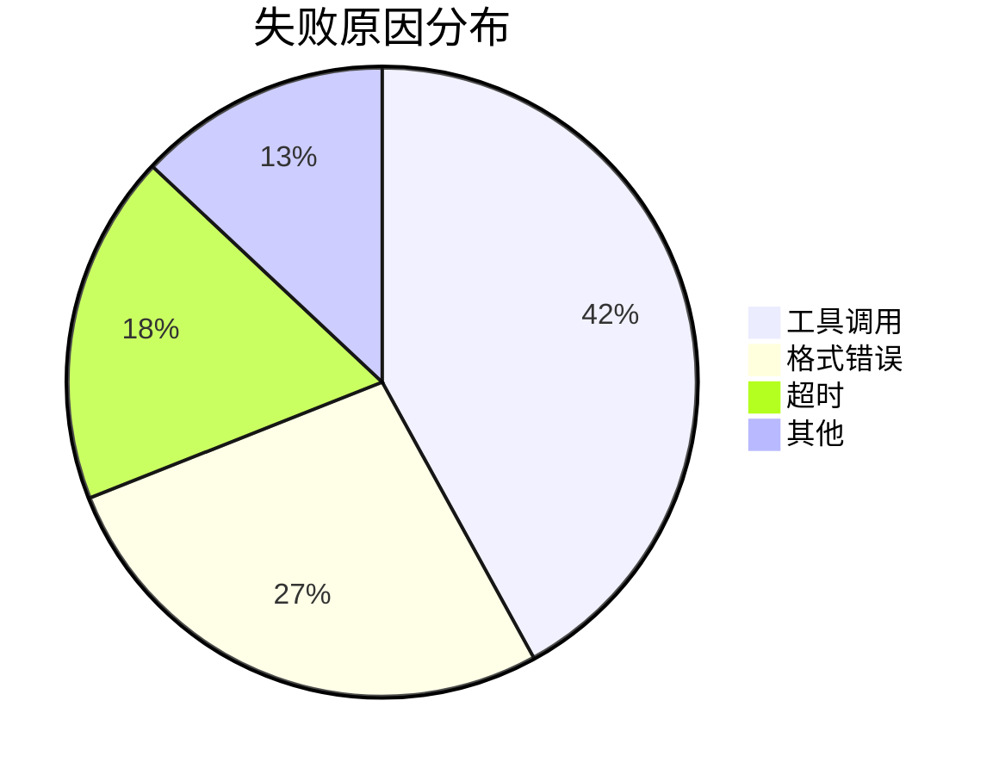
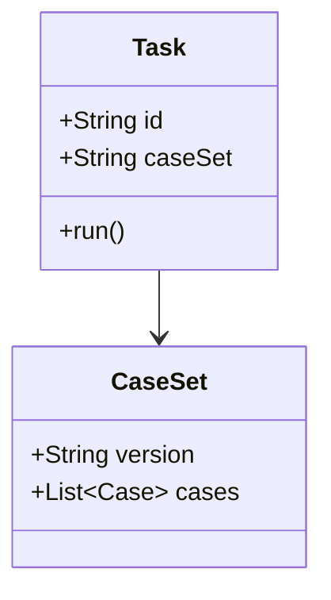

# Mermaid 规范（六类）

只用来做**自动布局更划算**的图：流程图、时序图、思维导图、甘特图、饼图、类图。版式控制力换来的是语法成本，所以文字必须短。

## 通用规则

- 一张 `.mmd` 只放一个图，首行声明类型，不要写 front-matter 样式块（画板不认主题变量）。
- 节点文字 ≤ 8 个汉字；超过就拆节点。
- 不要用 `<br/>`、HTML 实体、emoji 图标；这些会让整块降级成空。
- 写完先本地渲染 PNG：

```bash
npx -y @larksuite/whiteboard-cli@^0.2.13 -i x.mmd -o x.png        # 目检
npx -y @larksuite/whiteboard-cli@^0.2.13 -i x.mmd --to openapi --format json \
  | lark-cli whiteboard +update --whiteboard-token <board> --source - --input_format raw --as user
```

## 1 flowchart


- 方向默认 `LR`；判断用 `{}`，起止用 `([ ])`。
- 边上的条件写在 `| |` 里，别放在节点里。
- 一张图 ≤ 10 节点、≤ 2 个判断。

## 2 sequenceDiagram


- `participant X as 别名` 的别名必须单行短词。
- 请求 `->>`、返回 `-->>`，语义要分清。
- 不要用 `Note over` 写长句，画板里会挤在一条窄带。

## 3 mindmap


- 缩进即层级，用 2 空格，别用 tab。
- 一级分支 ≤ 5，层级 ≤ 4。
- 根节点用 `(( ))`，其余纯文本。

## 4 gantt


- `dateFormat` 必写；`axisFormat` 控制刻度，避免长日期撑爆画布。
- 用 `done / active` 表达状态，别用颜色。
- `after b1` 表达依赖，比手写日期稳。

## 5 pie


- 标签加引号；合计不必等于 100，Mermaid 会自己算百分比。
- 超过 6 片就换条形图（走 HTML 路线）。

## 6 classDiagram


- 只写关键字段（≤ 4 个）与方法（≤ 3 个）。
- 泛型用 `List~Case~`，不要用 `<>`（会被当标签）。

## 落到文档

```xml
<whiteboard type="mermaid" path="@diagrams/x.mmd"></whiteboard>
```

创建文档时：`lark-cli docs +create --as user --content @doc.xml`。之后要改，用 `whiteboard +update --input_format mermaid --overwrite` 重写。

## 已知边界

- 思维导图/时序图节点文字过长会横向撑爆画布，且 `--check` 对 Mermaid 只做结构渲染、不做文本溢出检测，必须看 PNG。
- 甘特图跨年任务会压缩到看不清，长周期项目请按季度拆图。
